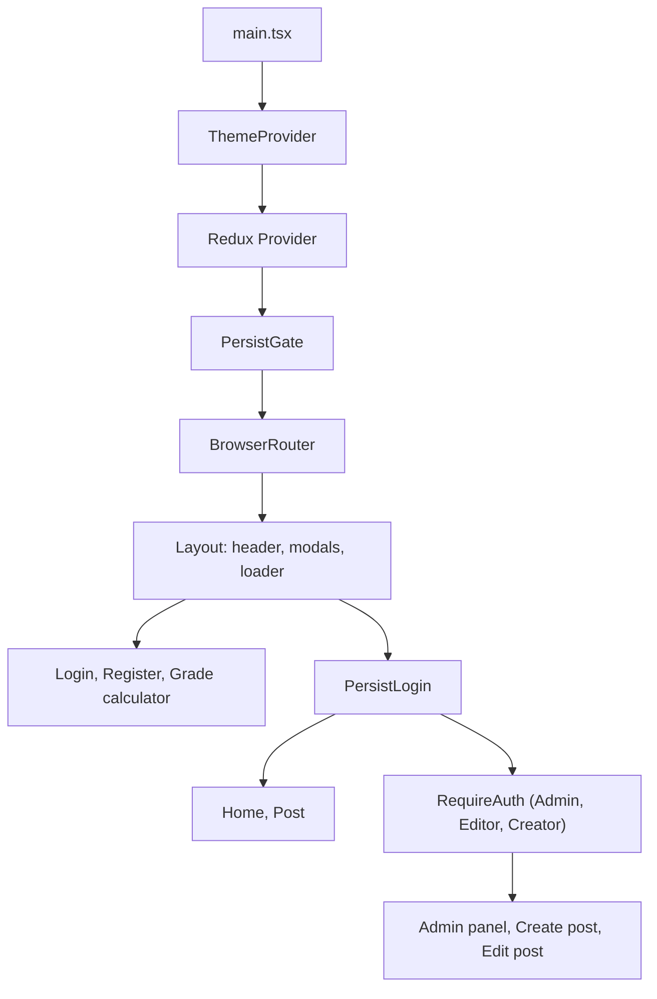
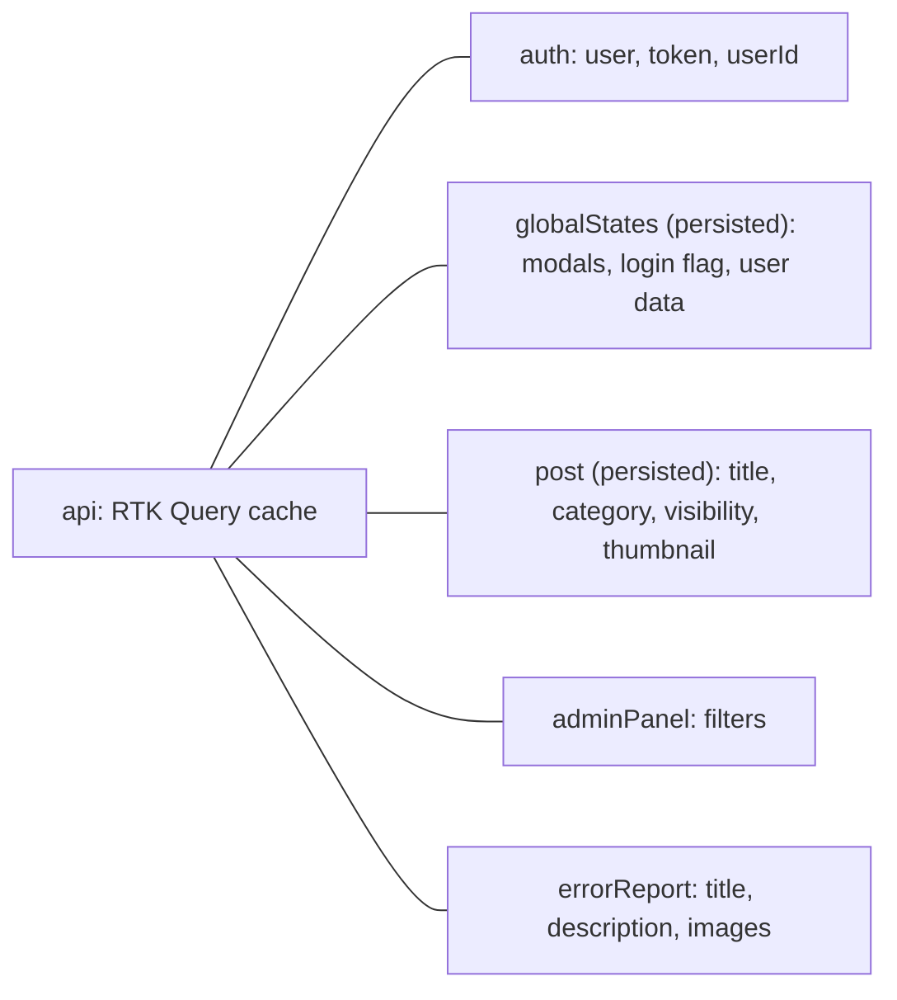

# Andrew Ponad — Frontend

Developed from January 2024 to September 2024.

Single-page application for a multi-author content platform, built for my computer science teacher at school. Readers browse and search posts by category, authors compose posts in a row-based visual editor, and administrators manage users, categories, and bug reports from one panel. A grade calculator for the teacher's grading scales ships alongside the posts.

The REST API behind it (Node.js, Express, MongoDB) lives in a separate repository: [andrew-ponad-backend](https://github.com/viventer/andrew-ponad-backend).

The interface is in Polish, because that is the language of the product.

## Features

- Registration and login with live, field-by-field validation that mirrors the server rules
- Silent access-token refresh: a request that fails with 403 is retried once after a call to `/refresh`
- Optional "remember this device" login that restores the session on page load from the refresh cookie
- Role-aware routing and UI (User, Verified, Creator, Editor, Admin)
- A row-based post editor with six layouts mixing rich text, images, and embedded video
- Drafts created on the server as soon as the editor opens, then autosaved every 30 seconds
- Five post visibility levels: public, unlisted, private, draft, and verified-only
- Home page with an auto-rotating slider and a "most popular" list ordered by views
- Search by title and category, plus filters in the admin panel by visibility, category, role, and status
- Admin panel tabs for posts, categories, users (with role changes), and bug reports (with a status workflow)
- A bug-report modal reachable from every page, with a rich-text description and screenshots
- All user-authored HTML sanitized before it is rendered
- A grade calculator that turns a maximum score into point ranges for three test types
- Global error, success, confirmation, and loading overlays driven from the store

## Tech stack

| Technology | Role |
| --- | --- |
| React 18, TypeScript | Components and typed props, API payloads, and store state |
| Vite 4 | Dev server with HMR and the production build |
| Redux Toolkit, React Redux | Slices for auth, posts, the admin panel, bug reports, and global UI state |
| RTK Query | API layer with caching, tag invalidation, and the re-auth wrapper |
| `redux-persist` | Keeps UI state and the post being edited across reloads |
| React Router 6 | Nested routes, layout outlet, and route guards |
| styled-components 6 | Component styles and a shared colour theme via `ThemeProvider` |
| `react-quill` | Rich-text editor for post rows and bug-report descriptions |
| `react-dropzone` | Image upload with type and 1 MB size limits |
| `react-player` | Embedded video rows from a link |
| `react-medium-image-zoom` | Click-to-zoom images in published posts |
| `dompurify` | Sanitizing stored HTML before `dangerouslySetInnerHTML` |
| `jwt-decode` | Reading the username and roles from the access token |
| `validator` | Email validation on the registration form |
| Font Awesome, `react-spinners` | Icons and the global loading indicator |
| Docker, nginx | Multi-stage production image serving the static build over HTTPS |

## Architecture

`main.tsx` wraps the app in the theme provider, the Redux store, the persistence gate, and the router. Every route renders inside one `Layout`, which owns the header, the global modals, the loader, and the bug-report window. Each feature lives in its own folder under `src/views` and keeps its components, styles, slices, and types together.



### Layout

```
src/main.tsx            providers, theme colours, React DevTools disabled
src/App.tsx             route tree and the 404 page
src/redux/              store setup and the base RTK Query API with re-auth
src/hooks/              auth, validation, filtering, and translation helpers
src/views/auth/         login, registration, session restore, route guard
src/views/home/         slider, most popular posts, footer
src/views/post/         post page and the post editor
src/views/searching/    search box and results
src/views/admin-panel/  posts, categories, users, and bug-report tabs
src/views/error-reports/ bug-report modal and its editor
src/views/user-info/    account box: logout, password change, account deletion
src/views/grade-calculator/ calculator and grading-scale data
src/views/global/       layout, header, modals, shared components and styles
Dockerfile, nginx.conf  production image and web server config
```

### State



The access token lives only in the `auth` slice in memory and is never written to `localStorage`. Server data (posts, users, categories, bug reports) stays in the RTK Query cache, normalized with `createEntityAdapter` and tagged per entity so a mutation refetches only what it changed.

## Key decisions

### Re-authenticating inside the API layer

Every request goes through one base query that sends cookies and the Bearer token. A 403 calls `/refresh`, stores the new access token, and retries the original request. A failed refresh for a remembered device shows "session expired", and a 429 becomes a "too many requests" message.

### Remembering a device

"Remember this device" stores only a flag in `localStorage`. On load, `PersistLogin` calls `/refresh` when that flag is set and no token is in memory, so a reload keeps the session without storing the token. Login, registration, and the grade calculator sit outside this wrapper.

### Roles in the client

`useAuth` reads the username and roles from the access token. `RequireAuth` blocks routes the token does not allow, and the admin panel shows the categories, users, and bug-report tabs only to an Admin. These checks shape the UI; the API still authorizes every read and write.

### Row-based post editor

A post is an array of rows, each with two slots, switchable between text, image, text with an image, two images, and video. Images are stored as base64 data URLs up to 1 MB, and a video slot takes a link. Opening the editor creates a `draft` immediately and autosaves it every 30 seconds.

### Rendering untrusted HTML

Post text and bug-report descriptions are stored as Quill HTML and pass through `DOMPurify.sanitize` before they are rendered.

### Visibility and listing

The slider, the "most popular" list, and search drop `draft` and `unlisted` posts. Unlisted posts stay reachable by a direct link. Opening a post increments the view counter, which the server rate-limits.

### One filter for every list

`useGetFilteredData` filters posts, users, categories, and bug reports. Polish labels are translated back to API values, and placeholders such as "Dowolna" count as no filter.

### Validation that matches the server

Forms apply the same rules as the API while the user types: password length and character classes, Polish names, and bug-report length measured after tags are stripped. Invalid fields turn red, and the submit button stays disabled until the form is complete.

### Grade calculator

Three scales in `gradingScales.json` turn a maximum score into point ranges for Polish grades from `ndst` to `bdb`. The matching grade is highlighted, and neighbouring ranges are chained so they neither overlap nor leave a gap.

### Production build

The Docker image builds with Node 20 and nginx serves the static files. HTTP redirects to HTTPS, unknown paths fall back to `index.html` so client-side routes survive a reload, and React and Redux DevTools are disabled in the bundle.
